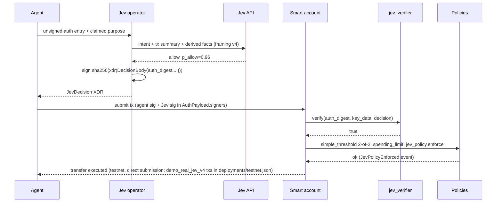
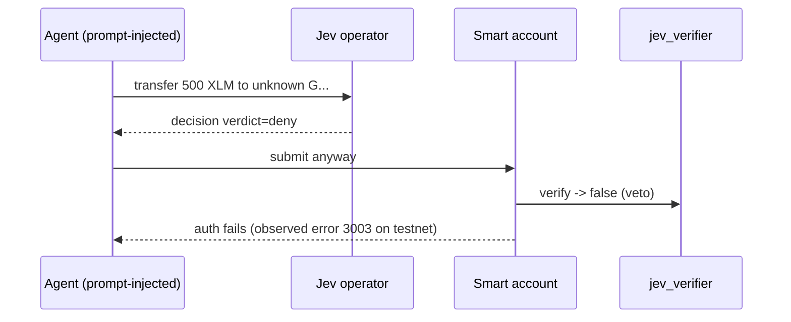
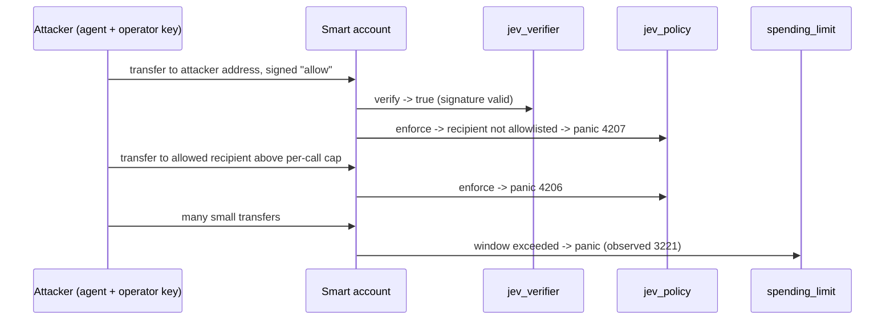
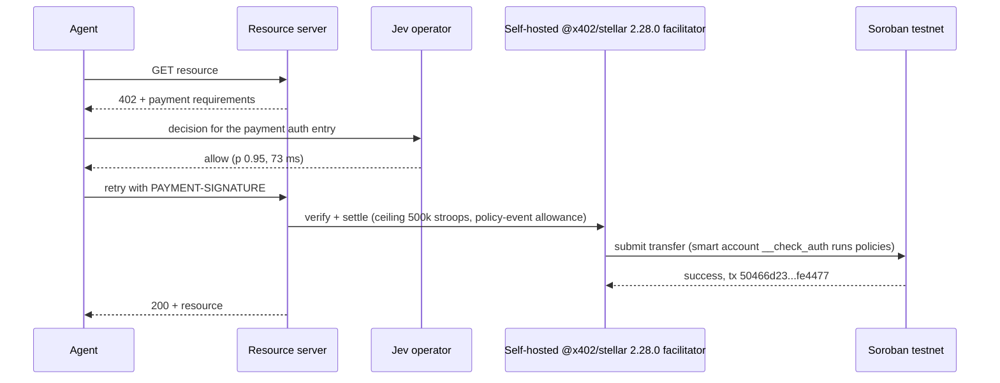

# Flows

Testnet evidence for these flows: tx hashes and observed error codes in [`deployments/testnet.json`](../../deployments/testnet.json) and logs in `deployments/`.

## 1. Install an agent session

```mermaid
sequenceDiagram
  actor Owner as Owner (passkey)
  participant UI as Web console / CLI
  participant SA as OZ smart account
  participant P as jev_policy
  Owner->>UI: define intent (recipients, caps, purpose), pick tau=0.80
  UI->>UI: intent_hash = sha256(canonical intent JSON); model_id = sha256("jev-1.13.0")
  UI->>UI: key_data = encode_key(JevKey{operators,k,model_id,intent_hash,tau,template,max_age})
  Owner->>SA: add_context_rule(CallContract(token), signers=[agent, External(jev_verifier,key_data)],<br/>policies={simple_threshold(2), spending_limit, jev_policy(params)})
  SA->>P: install(params, rule, account)
  P->>P: require Jev signer on rule; store params; extend TTL
  SA-->>Owner: rule id (demo tx install_session)
```

## 2. Payment, allowed



## 3. Escalate to the owner

Jev returns `escalate`, or `allow` with `p_allow < tau`. The operator still returns a signed decision, but `jev_verifier.verify` returns false, so the 2-of-2 threshold fails. The client routes the request to the owner, who can approve with the passkey under a separate owner rule [TODO: escalation UX beyond console simulator]. At tau 0.80, 10.7% (dev set) and 12.0% (holdout) of legitimate payments in the benchmark are escalated.

## 4. Deny



## 5. Compromised operator

The operator key is stolen and signs `allow` for anything. On-chain rules still apply:



Worst-case loss = min(spending_limit window, per-call caps x calls) restricted to allowlisted contracts and recipients. Recovery: owner removes the session rule with the passkey.

## 6. x402 payment

### 6a. Self-hosted facilitator (settles on testnet)



A one-time storage-rent prefund (`ExtendFootprintTTL`, tx `9bab6edd…`) keeps the warm payment under the ceiling. Details: [x402-settlement.md](x402-settlement.md).

### 6b. OZ hosted facilitator (still refused)

```mermaid
sequenceDiagram
  participant A as Agent
  participant F as OZ x402 facilitator (testnet)
  A->>F: verify(payload)
  F-->>A: invalid_exact_stellar_payload_fee_exceeds_maximum
  Note over A,F: fee 310k-5.73M stroops vs 50k ceiling; also rejects non-transfer policy events.
```

Upstream fix (policy-event allowance + smart-account fee profile) is a grant deliverable. Options are in [open-questions.md](open-questions.md).
