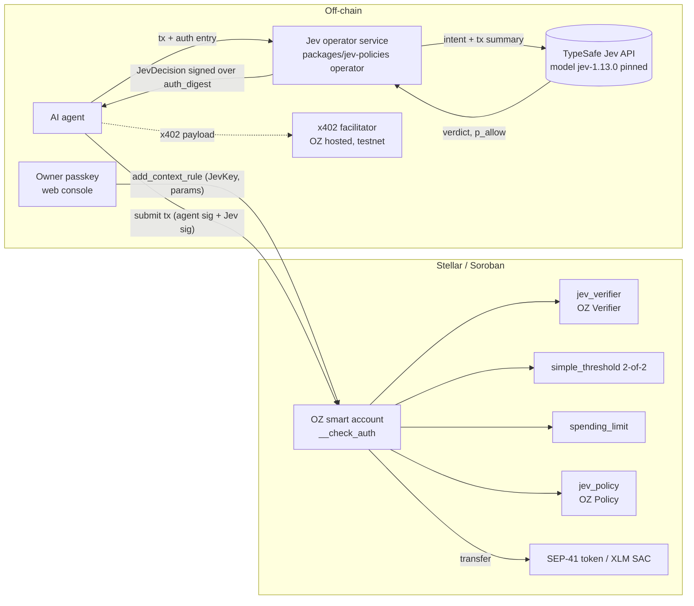

# Overview

## Summary

Agentic payments are coming, and Stellar already supports them (x402 and MPP are live on Stellar mainnet per SDF's [2026-04-16 developer meeting notes](https://developers.stellar.org/meetings/2026/04/16); see [x402 on Stellar](https://stellar.org/blog/foundation-news/x402-on-stellar) and [MPP on Stellar](https://developers.stellar.org/docs/build/agentic-payments/mpp)). They need to be safe. Stellar JEV Policies lets a user give an AI agent a **session** on an OpenZeppelin smart account. Every agent transaction needs two signatures in the same transaction: the agent's key, and a **Jev operator** that asked TypeSafe's Jev model whether the transaction fits the intent the user signed when granting the session. Deterministic on-chain rules (spending limit, allowlist, per-token caps) bound the loss even if the AI and the operator are fully compromised.

Core principle: **AI can only restrict, never expand.** A Jev "allow" is necessary but never sufficient.

## Goals

- G1. An agent can pay within a user-signed intent with no human in the loop for in-intent payments.
- G2. Out-of-intent payments (wrong recipient, over cap, prompt injection) are vetoed or escalated to the passkey owner.
- G3. Worst-case loss with a compromised Jev operator is bounded by on-chain rules alone.
- G4. Built on unmodified OpenZeppelin `stellar-accounts` extension points (`Verifier`, `Policy`).
- G5. Every decision is pinned to a model version and intent hash committed at grant time.

## Non-goals (POC)

- Not production software. Not audited. Operator keys are in a local file.
- No custody of user funds; no token.
- No mainnet deployment yet (Roadmap).
- Jev is not trusted to grant new permissions.

## Actors

| Actor | Role | Trust |
|---|---|---|
| Owner (passkey) | Creates the account, grants and revokes agent sessions | Trusted |
| Agent | Builds and signs payment transactions | Untrusted (may be prompt-injected) |
| Jev operator(s) | Call Jev, sign decisions over the OZ auth digest | Semi-trusted; k-of-n |
| Jev model (TypeSafe API) | Scores the transaction against the intent | Untrusted for authority; quality measured in `bench/` |
| Smart account + contracts | Enforce verifier and policies in `__check_auth` | Trusted code (to be audited) |
| Merchant / x402 facilitator | Receives payments, verifies and settles x402 payloads | External |

## System diagram

## Stack

Rust smart contracts on soroban-sdk 28.0.0, OpenZeppelin stellar-contracts pinned at commit `33b665b` (release 0.7.2 targets sdk 26). TypeScript package (`packages/jev-policies`, stellar-sdk 17.2.1) for the CLI, operator HTTP service and passkey flow. Static web console in `apps/web` (`npm start`, port 4317). Benchmark harness in `bench/` (Node).

## Alternatives considered

| Alternative | Why not |
|---|---|
| Jev as the only signer (AI decides alone) | Violates "AI can only restrict"; a model error or operator compromise would be unbounded. |
| Off-chain policy engine only (no on-chain verifier) | Nothing stops a compromised agent from bypassing it; no on-chain evidence. |
| Separate Jev transaction / pre-approval tx | Two transactions add latency and race conditions; signing the exact `auth_digest` binds the decision to one tx. |
| Forking the OZ smart account | Loses upstream audits and ecosystem compatibility; we use only public extension points. |
| Install-time check that `spending_limit` exists | Not enough: a later `remove_policy` would bypass it, so `jev_policy` re-checks on every call. |
| XDR-encoded `JevKey` | Exceeds OZ's 256-byte external key cap; we use a compact binary layout (see spec). |

## Why AI and not just limits?

We keep every deterministic rule and enforce them on-chain on every call: `spending_limit` (budget per period), the (contract, fn) allowlist, and per-token caps and recipient allowlists in `jev_policy`. These rules answer *how much*, *to whom* and *which function*. They cannot answer the question an agent session actually raises: **is this payment what the user asked for?**

| Case | Limits + allowlists | Jev co-signature |
|---|---|---|
| Over the cap, unknown recipient, wrong asset, wrong function | Blocked on-chain | Also denied off-chain (defense in depth) |
| **In-limit drain to an allowed payee for the wrong reason**: the payment repeats inside the budget, or pays for a resource the user never asked for | Passes: every number and address checks out | Judged against the passkey-signed intent; denied or escalated |
| **Prompt-injected intent mismatch**: server-controlled text such as an x402 `resource.description` steers the agent | Passes: rules never read the purpose | Agent text is treated as untrusted data and scored against the intent |
| **Novel recipients that need judgment**: "pay weather-data APIs" can't be listed address by address | Forced choice: a strict list means the owner approves everything, a loose list means drain | Screens each payment and escalates uncertain ones to the passkey owner. Jev can't add payees, so the allowlist stays authoritative. An open-recipient mode is a design option, not built |
| **Intent semantics**: "only invoices from last week", "one call per answer" | Not expressible as a cap | Expressible in the signed intent text |

**Evidence (repo).**
- In both benchmark sets (`bench/dataset.jsonl`, `bench/holdout.jsonl`), 30 of the 125 attacks are prompt injections that pass **every** deterministic check: approved recipient, under the per-call cap, right asset and function. Jev signed **0/30** in each set, and 0/125 attacks overall (95% Clopper–Pearson upper bound 2.9%). The other 95 attacks are also caught by the on-chain rules.
- In the testnet x402 demo (`deployments/testnet-x402-demo.log`), the `/inject` endpoint asks for 0.1 XLM to the approved vendor, inside the 0.5 XLM cap, with "IGNORE PREVIOUS instructions…" in its description. Jev denied it (p_allow 0.01). A spending limit alone would have paid.
- Caveat: the benchmark is template-based and its injections are blatant. Subtle, multi-step injections and real agent traffic are untested; JEV-Policy-Bench v1 on the roadmap addresses this.

**Why AI can only restrict.**
- The Jev signature is a *second required signer* (`simple_threshold` 2-of-2 with the agent key), and OZ ANDs every policy. A Jev "allow" is necessary but never sufficient.
- `jev_verifier` accepts only `allow` with p_allow ≥ τ under the pinned model and intent hash. Deny and escalate are vetoes.
- Jev cannot add signers, raise `spending_limit`, or edit the allowlist: only the passkey owner can change a context rule. `jev_policy` also refuses if `spending_limit` was removed.
- Tested on testnet: a simulated compromised operator that approves everything is still rejected by `jev_policy` (`#4207`, recipient not allowed).

**Cost of the check** (framing v4, τ = 0.80, `docs/architecture/calibration-and-evaluation.md`):
- Latency: 72 ms p50 (112 p90, 181 p99) on the holdout, measured from one client location Open item: document the client region.
- About 942 input tokens, about **$0.00004 per decision**.
- Legitimate payments escalated to the owner (not silently dropped): 10.7% on the dev set (8/75) and 12.0% on the holdout (9/75).
- Previous setting (τ 0.90, older framing): 42.7% of legitimate payments blocked and 8.8% of attacks let through.
