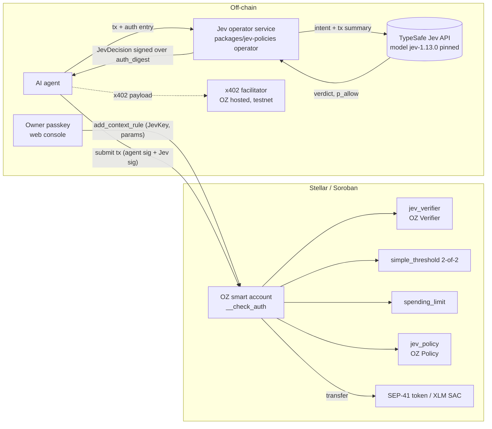

# Overview

## Summary

Agentic payments are coming, and Stellar already supports them (x402 and MPP are live on mainnet [TODO: link primary sources]). They need to be safe. Stellar JEV Policies lets a user give an AI agent a **session** on an OpenZeppelin smart account. Every agent transaction needs two signatures in the same transaction: the agent's key, and a **Jev operator** that asked TypeSafe's Jev model whether the transaction fits the intent the user signed when granting the session. Deterministic on-chain rules (spending limit, allowlist, per-token caps) bound the loss even if the AI and the operator are fully compromised.

Core principle: **AI can only restrict, never expand.** A Jev "allow" is necessary but never sufficient.

## Goals

- G1. An agent can pay within a user-signed intent with no human in the loop for in-intent payments.
- G2. Out-of-intent payments (wrong recipient, over cap, prompt injection) are vetoed or escalated to the passkey owner.
- G3. Worst-case loss with a compromised Jev operator is bounded by on-chain rules alone.
- G4. Built on unmodified OpenZeppelin `stellar-accounts` extension points (`Verifier`, `Policy`).
- G5. Every decision is pinned to a model version and intent hash committed at grant time.

## Non-goals (POC)

- Not production software. Not audited. Operator keys are in a local file.
- No custody of user funds; no token.
- No mainnet deployment yet (Grant, T3).
- Jev is not trusted to grant new permissions.

## Actors

| Actor | Role | Trust |
|---|---|---|
| Owner (passkey) | Creates the account, grants and revokes agent sessions | Trusted |
| Agent | Builds and signs payment transactions | Untrusted (may be prompt-injected) |
| Jev operator(s) | Call Jev, sign decisions over the OZ auth digest | Semi-trusted; k-of-n |
| Jev model (TypeSafe API) | Scores the transaction against the intent | Untrusted for authority; quality measured in `bench/` |
| Smart account + contracts | Enforce verifier and policies in `__check_auth` | Trusted code (to be audited) |
| Merchant / x402 facilitator | Receives payments, verifies and settles x402 payloads | External |

## System diagram

## Stack

Rust smart contracts on soroban-sdk 28.0.0, OpenZeppelin stellar-contracts pinned at commit `33b665b` (release 0.7.2 targets sdk 26). TypeScript package (`packages/jev-policies`, stellar-sdk 17.2.1) for the CLI, operator HTTP service and passkey flow. Static web console in `apps/web` (`npm start`, port 4317). Benchmark harness in `bench/` (Node).

## Alternatives considered

| Alternative | Why not |
|---|---|
| Jev as the only signer (AI decides alone) | Violates "AI can only restrict"; a model error or operator compromise would be unbounded. |
| Off-chain policy engine only (no on-chain verifier) | Nothing stops a compromised agent from bypassing it; no on-chain evidence. |
| Separate Jev transaction / pre-approval tx | Two transactions add latency and race conditions; signing the exact `auth_digest` binds the decision to one tx. |
| Forking the OZ smart account | Loses upstream audits and ecosystem compatibility; we use only public extension points. |
| Install-time check that `spending_limit` exists | Not enough: a later `remove_policy` would bypass it, so `jev_policy` re-checks on every call. |
| XDR-encoded `JevKey` | Exceeds OZ's 256-byte external key cap; we use a compact binary layout (see spec). |
